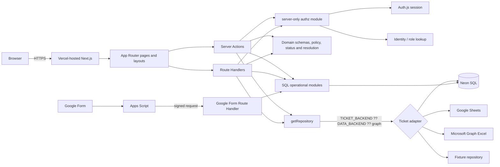

# Current Architecture

> **Source baseline:** `f4ead9f0225de23b75c0e5b22dcc7f4f1713a535`  
> **Evidence date:** 2026-11-20  
> **Runtime caveat:** source behavior is verified at this commit; environment selector values and effective production persistence are not.

## Deployment and source baseline

The production alias object was observed mapped to a READY production deployment associated with commit `f4ead9f0225de23b75c0e5b22dcc7f4f1713a535`. A newer READY production-target deployment at `e4ddb54e38c18b8bc80df32d95ab93fe82382b36` was not shown mapped to the canonical alias in the available evidence. Do not describe the newer deployment as live without checking alias promotion again.

The Vercel project is a Next.js project using Node 24.x. Deployment protection was reported enabled for deployment URLs except custom domains; this is a platform-level gate, separate from application authentication and authorization. Environment values were not inspected because the available read interface returned the entire environment set and could expose secrets.

## Component architecture



The component diagram shows code-supported paths. It does not say which ticket adapter or SQL operational paths are active in production.

## App Router responsibilities

The Next.js application is organized under `src/app/`.

- Portal pages and layouts render employee and IT workspace routes.
- `src/app/(portal)/actions.ts` contains ticket creation and update Server Actions.
- API Route Handlers under `src/app/api/` provide Auth.js handlers, health checks, ticket/attachment endpoints, Google Form intake, inventory attachments, and agreement endpoints.
- `src/auth.ts` configures Auth.js.
- `src/lib/domain/` holds application-level types, Zod schemas, policy functions, status normalization, resolution rules, activity descriptions, and translation logic.
- `src/lib/excel/` defines the ticket repository contract and selects a provider implementation.
- `src/lib/sql/` contains SQL connection setup, ticket persistence, Form intake writes, operational records, login limits, and agreement logic.
- `src/lib/google-sheets/` contains the spreadsheet ticket adapter and its client.

Server Actions and Route Handlers are server-side entry points, but they are not automatically safe because of their location. Each operation still requires its own authentication, authorization, validation, and data-access checks.

## Authentication and identity resolution

### Auth.js setup

`src/auth.ts` configures Auth.js `5.0.0-beta.32` with a Credentials provider named for IT staff.

The `authorize` callback:

1. Immediately returns `null` unless `DATA_BACKEND === "sql"`.
2. Trims and bounds the submitted username and bounds the password.
3. Reads the expected shared username and stored password hash from runtime configuration.
4. Uses `consumeSharedLoginAttempt` keyed by a keyed hash of the client address.
5. Compares normalized usernames using constant-time comparison.
6. Verifies a `scrypt` password hash; verification errors are converted to a failed login.
7. Clears the address’s login attempts after successful authentication.
8. Returns a generic identity with ID `shared-it`.

Sessions use the JWT strategy, an eight-hour maximum age, and an HTTP-only, same-site lax session cookie. In production the cookie is marked secure and uses a `__Secure-` name. The source has `trustHost: true`. These are source facts; effective values and upstream proxy behavior are deployment matters.

`src/lib/sql/auth-rate-limit.ts` permits eight attempts per key in a 15-minute window. The persisted key is an HMAC using the Auth.js secret; raw client addresses are not stored in `lacc_auth_login_limits`.

### Application role resolution

`src/lib/authz.ts` is marked `server-only`.

- `getOptionalEmployee()` has an `AUTH_BYPASS` branch only when `NODE_ENV !== "production"`.
- With `DATA_BACKEND === "sql"`, only session ID `shared-it` resolves to the synthetic generic `IT_AGENT` employee.
- Outside SQL mode, the module reads the session email, rejects an `EMPLOYEE` according to `staffRole` when in production, then calls `getRepository().getEmployeeByEmail(email)`.
- `requireEmployee()` redirects to the Auth.js sign-in path if no employee resolves.
- `requireAgent()` rejects only the `EMPLOYEE` role.
- `requireAdmin()` requires exactly `ADMIN`.

This mode split is important: SQL mode does not resolve individual employees from SQL; non-SQL mode depends on the ticket repository’s employee lookup.

**Security review item:** the baseline Google Sheets repository returns an `ADMIN` role from `getEmployeeByEmail` for any nonempty email. The source does not prove that this backend is active, but if it were selected, this fallback deserves correction and review before production authorization relies on it.

## Backend selection

Ticket and operational data selection are separate.

### Ticket repository selector

`src/lib/excel/index.ts:getRepository()` caches a singleton repository and selects:

```text
TICKET_BACKEND ?? DATA_BACKEND ?? "graph"
```

Behavior:

| Selected value | Repository | Behavior |
|---|---|---|
| `fixture` | `FixtureTicketRepository` | Throws in production; intended for non-production fixtures |
| `sql` | `SqlTicketRepository` | SQL ticket, event, message, and attachment persistence |
| `google` | `GoogleSheetTicketRepository` | Reads and updates the source Google Sheet; does not provide message, event, or attachment persistence |
| Any other value | `GraphTicketRepository` | Microsoft Graph/Excel repository |

The source does not validate arbitrary nonempty selector values into an error; unrecognized values fall through to Graph.

### Operational SQL path

`DATA_BACKEND` separately controls behavior including shared login acceptance and Google Form intake availability. SQL modules under `src/lib/sql/` support onboarding, inventory, audit, rate limits, agreements, and Form intake. This means a deployment can use SQL operations while using another ticket repository, or vice versa.

For SQL connections, `src/lib/sql/client.ts:database()` selects `APP_DATABASE_URL ?? DATABASE_URL`, calls `assertSafeSqlConfiguration`, then constructs a `pg` pool with maximum size 3 and 10-second connection and idle timeouts. Missing connection configuration throws an error. The actual configured URL was not inspected.

## Ticket persistence and error propagation

The `TicketRepository` interface in `src/lib/excel/repository.ts` defines employee lookup, list/detail, create/update, messages, attachments, event listing, and health check methods. Provider implementations do not have equivalent capabilities.

### SQL repository

`SqlTicketRepository` in `src/lib/sql/repository.ts`:

- Uses parameterized PostgreSQL queries.
- Reads `Ticket` JSON from `lacc_tickets.data`.
- Checks `canReadTicket` on detail retrieval.
- Filters internal notes from employee detail responses and hides event history from employees.
- Creates a ticket and its initial `CREATED` event in one transaction.
- Uses unique `operation_uid` values for idempotency.
- Locks ticket rows during updates, checks `expectedVersion`, increments the version, and writes event/note records in the same transaction.
- Rolls back failed create/update transactions and releases the connection.
- Enforces `canManageTickets` for ticket updates and `canCreateMessage` for message creation.
- Checks attachment size, count, total bytes, ticket existence, and requester/agent read permission before inserting content.

Errors from the SQL layer can include the repository’s `AuthorizationError`, `ConflictError`, `NotFoundError`, or `WorkbookUnavailableError`, as well as database errors. The Server Action maps selected repository errors to user-facing action state; unhandled errors are rethrown to Next.js error handling.

### Google Sheets repository

`GoogleSheetTicketRepository` reads a configured table, maps rows to tickets, applies an import cutoff, and derives a version from selected row metadata. It directly updates sheet columns for status, updated time, completion marker, staff, resolved time, and resolution notes.

It does not implement the same persistence contract as SQL:

- `createTicket()` throws `WorkbookUnavailableError`; requests are directed to the Form.
- `addMessage()` throws because messages are not stored in the source form.
- `addAttachment()` throws because attachments are not stored there.
- `listEvents()` returns an empty list.
- `updateTicket()` checks agent/admin policy and expected version, then writes the sheet row.

A successful write does not create the SQL event/message history described for SQL mode.

### Graph repository

`GraphTicketRepository` uses `GraphExcelClient` and workbook access-token logic. It requires workbook location configuration, creates a Graph workbook session for an operation, and closes the session in `finally`. Missing location configuration becomes `WorkbookUnavailableError`. Detailed Graph permissions, workbook table state, and live use were not verified.

### Server Action behavior

In `src/app/(portal)/actions.ts`:

- `createTicketAction` calls `requireEmployee`, maps form fields, validates with `ticketCreateSchema`, then calls `getRepository().createTicket`. It converts `WorkbookUnavailableError` to an action error; other errors propagate.
- `updateTicketAction` calls `requireAgent`, derives status from the `resolved` checkbox/current status, obtains staff options when `TICKET_BACKEND === "google"`, normalizes `completedBy`, validates with `ticketUpdateSchema`, and requires a completed-by value when resolving. It calls `updateTicket`, revalidates the ticket and `/it` paths, and returns saved status/version fields. It maps authorization, conflict, not-found, and workbook-unavailable errors to action state; other errors propagate.
- The update schema contains no `assigneeUid`, and the action does not submit one. The SQL update method does not edit assignment. Although `Ticket` contains `assigneeUid` and list filters can filter by assignee, assignment is not implemented by this ticket update path.

## Google Forms and Apps Script

`src/app/api/intake/google-form/route.ts` is a Node.js, force-dynamic Route Handler. It returns 503 unless SQL backend selection and both intake configuration values are present.

The handler:

1. Requires JSON content type.
2. Limits the request body to 20,000 bytes.
3. Requires a timestamp and SHA-256 HMAC signature; timestamps must be within five minutes.
4. Parses JSON and validates a strict Zod payload.
5. Requires the submitted form ID to match the configured source form.
6. Validates request-type and conditional new-hire fields.
7. Creates either an onboarding request via `createOnboardingRequest` or a ticket via `createGoogleFormTicket`.
8. Returns 200 for a detected duplicate, 201 for a new record, or a specific 4xx/5xx response for validation, authorization, configuration, or persistence failure.

`googleFormOperationUid()` deterministically derives an operation UUID from the Form and response IDs. `createGoogleFormTicket()` inserts ticket data and a `CREATED` event transactionally and uses both the operation identifier and the partial unique source-response index for duplicate handling.

`integrations/google-forms/Code.gs` contains form-submit and retry logic. Its installer function checks script properties and the active Form identity before it installs triggers; it also changes Form settings and removes a response destination. Those are source-code behaviors of the installer, not evidence that it was run against the production Form during this inspection. A prior Apps Script GUI inspection showed trigger rows but did not conclusively identify that project as the production-linked Form.

## Sequence: ticket update in SQL mode

```mermaid
sequenceDiagram
  participant B as Browser
  participant A as updateTicketAction
  participant Z as ticketUpdateSchema
  participant R as SqlTicketRepository
  participant DB as PostgreSQL
  B->>A: Submit current version and fields
  A->>A: requireAgent()
  A->>Z: Validate operation UID, version, status, priority, resolution
  Z-->>A: Valid input or action error
  A->>R: updateTicket(ticket UID, input, actor)
  R->>DB: BEGIN; SELECT ticket FOR UPDATE
  R->>DB: Check operation replay and expected version
  R->>DB: UPDATE ticket JSON/version; INSERT event and/or note
  R->>DB: COMMIT
  R-->>A: Saved Ticket or typed error
  A->>B: Revalidated ticket/queue or action error
```

## External dependencies and planned work

- **Vercel:** hosts the Next.js runtime; deployment protection is not application RBAC.
- **Neon/PostgreSQL:** SQL persistence path; actual selected production ticket backend remains unknown.
- **Google Forms and Apps Script:** source-supported intake path; live trigger-to-Form linkage remains unverified.
- **Google Sheets:** alternate ticket source adapter; operational capabilities differ from SQL.
- **Microsoft Graph/Excel:** fallback/default ticket adapter for selector values other than `fixture`, `sql`, or `google`.
- **Entra ID:** individual OIDC authentication and MFA are planned; this baseline uses Auth.js Credentials and does not establish deployed Entra sign-in.
- **Exchange:** No Exchange provisioning or automation is implemented in this source baseline.

## Known discrepancies and open questions

| Question | Owner | Why it matters |
|---|---|---|
| What exact deployment currently owns the production alias? | Vercel administrator | Confirms current source baseline |
| Which `TICKET_BACKEND` and `DATA_BACKEND` values are active? | Vercel administrator and application owner | Determines actual persistence and auth path |
| Is the Google Sheets `ADMIN` fallback reachable in any deployed configuration? | Application owner | Security-sensitive role resolution |
| Which Apps Script project/Form is production-linked? | Google Workspace administrator | Determines live intake topology |
| Which Graph permissions and workbook tables are active? | Microsoft 365 and application owners | Needed to document effective Graph access |
| Who applies migrations and how are failures handled? | Database and application owners | Needed for release/runbook completeness |
| What is the approved Entra role mapping and MFA policy? | Entra administrator | Needed before documenting staff authentication |

## Source links

- [`src/auth.ts`](https://github.com/kooshxo/lacc-it-support/blob/f4ead9f0225de23b75c0e5b22dcc7f4f1713a535/src/auth.ts#L27-L78)
- [`src/lib/authz.ts`](https://github.com/kooshxo/lacc-it-support/blob/f4ead9f0225de23b75c0e5b22dcc7f4f1713a535/src/lib/authz.ts#L8-L43)
- [`src/lib/excel/index.ts`](https://github.com/kooshxo/lacc-it-support/blob/f4ead9f0225de23b75c0e5b22dcc7f4f1713a535/src/lib/excel/index.ts#L11-L27)
- [`src/lib/excel/repository.ts`](https://github.com/kooshxo/lacc-it-support/blob/f4ead9f0225de23b75c0e5b22dcc7f4f1713a535/src/lib/excel/repository.ts)
- [`src/lib/sql/client.ts`](https://github.com/kooshxo/lacc-it-support/blob/f4ead9f0225de23b75c0e5b22dcc7f4f1713a535/src/lib/sql/client.ts)
- [`src/lib/sql/repository.ts`](https://github.com/kooshxo/lacc-it-support/blob/f4ead9f0225de23b75c0e5b22dcc7f4f1713a535/src/lib/sql/repository.ts#L19-L129)
- [`src/lib/google-sheets/repository.ts`](https://github.com/kooshxo/lacc-it-support/blob/f4ead9f0225de23b75c0e5b22dcc7f4f1713a535/src/lib/google-sheets/repository.ts#L108-L146)
- [`src/app/(portal)/actions.ts`](https://github.com/kooshxo/lacc-it-support/blob/f4ead9f0225de23b75c0e5b22dcc7f4f1713a535/src/app/%28portal%29/actions.ts#L15-L47)
- [`src/lib/domain/schemas.ts`](https://github.com/kooshxo/lacc-it-support/blob/f4ead9f0225de23b75c0e5b22dcc7f4f1713a535/src/lib/domain/schemas.ts#L4-L41)
- [`src/app/api/intake/google-form/route.ts`](https://github.com/kooshxo/lacc-it-support/blob/f4ead9f0225de23b75c0e5b22dcc7f4f1713a535/src/app/api/intake/google-form/route.ts#L46-L160)
- [`src/lib/sql/google-form-intake.ts`](https://github.com/kooshxo/lacc-it-support/blob/f4ead9f0225de23b75c0e5b22dcc7f4f1713a535/src/lib/sql/google-form-intake.ts#L23-L112)
- [`integrations/google-forms/Code.gs`](https://github.com/kooshxo/lacc-it-support/blob/f4ead9f0225de23b75c0e5b22dcc7f4f1713a535/integrations/google-forms/Code.gs)
