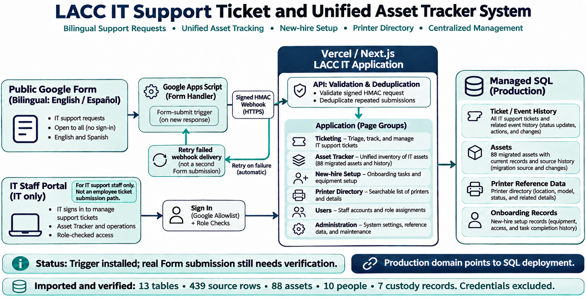

# LACC IT Support System: Architecture and Workflows

## What the diagram represents

The system combines one employee request intake with internal IT ticket handling and operational asset tracking in one Next.js application deployed on Vercel. Employees submit requests through the public bilingual Google Form only. The authenticated app is an IT staff workspace for viewing and managing requests and operations; it is not a second employee intake.

## Route groups and access

| Route group | Pages / routes | Purpose and access |
|---|---|---|
| Sign-in and public shell | `/`, `/auth/signin`, `/access-denied` | Landing, sign-in, and authorization-denied pages. The public Google Form is outside the app at `https://docs.google.com/forms/d/e/1FAIpQLSe1tsFZuYFNUgpwiRh9il72Plgczgj8_CDINrRH2v7LwBSfZQ/viewform`. |
| IT workspace | `/dashboard`, `/it`, `/it?state=ALL&page=1`, `/users`, `/admin` | IT staff view, search, triage, and manage tickets and reference data. Administration is restricted to the ADMIN role. |
| Ticket details | `/requests/[ticketNumber]` | Detail route used by IT staff to manage an individual ticket. Server-side role checks protect ticket access. |
| Legacy employee ticket pages | `/requests`, `/requests/new` | The current local source closes these pages and redirects IT staff to `/it`; this route change still needs deployment. Employee intake is intended to be the Google Form only. |
| Asset Tracker | `/inventory`, `/inventory/new`, `/inventory/[id]`, `/inventory/records`, `/inventory/review`, `/inventory/reports` | Search, create, inspect, reconcile, and report on inventory assets and imported source records. IT-facing routes require elevated access. |
| Asset people and custody | `/inventory/people`, `/inventory/people/new`, `/inventory/people/[id]`, `/inventory/checkouts`, `/inventory/issues` | Maintain assigned people, custody/checkouts, and asset issue records. |
| IT operations | `/it/onboarding`, `/it/onboarding/new`, `/it/printers` | Track new-hire equipment/access setup and consult printer reference information. |
| Ticket and inventory APIs | `/api/tickets/[ticketNumber]`, `/api/tickets/[ticketNumber]/attachments`, `/api/inventory/[assetId]/attachments` | Server-side ticket detail/update and protected attachment operations. Authorization and validation are applied in the app. |
| External form intake | `POST /api/intake/google-form` | Receives only signed Apps Script requests, validates HMAC, source form, LACC email and required fields, deduplicates by form response ID, then creates the ticket in SQL. |
| Auth and health | `/api/auth/[...nextauth]`, `/api/health` | Auth callbacks/session endpoints and deployment health status. |

All `/dashboard`, `/requests`, `/it`, `/users`, `/admin`, `/inventory`, and `/api` route access must go through server-side session and role checks; hiding a navigation item is not the authorization boundary.

## Workflows

### 1. Employee request from the Google Form

1. Employee opens the public bilingual Form without a Google sign-in requirement and provides the required contact and request details. This is the only employee ticket-submission path.
2. The form-bound Apps Script submit trigger maps the response fields to a small payload. It intentionally excludes PIN answers.
3. Apps Script signs the request with HMAC and posts it to `POST /api/intake/google-form` on the public Vercel domain.
4. The API validates the signature, timestamp, form ID, email domain, and required fields. Response ID idempotency prevents duplicate tickets.
5. The API inserts the ticket and its creation event into SQL. A temporary delivery failure is retried by Apps Script's time-based retry trigger.
6. IT sees the request in the support inbox and works it in the ticket system. Form-supplied email is not proof of identity; tickets remain marked unverified until IT checks the requester.

### 2. Employee portal ticket workflow

1. IT staff sign in to the app.
2. Server-side authentication and role checks determine which routes and records each IT user can access.
3. IT staff search, triage, assign, update, and communicate about Form-created tickets across requesters.
4. Ticket changes and attachments go through validated server actions or API handlers and persist to SQL, with ticket history/event records retained. The portal does not provide a second employee ticket submission path.

### 3. Unified asset and IT operations workflow

1. IT staff open **Asset Tracker** in the app navigation.
2. They search asset records, people, and custody history; perform checkouts and issue tracking; and use reports/review pages for reconciliation.
3. IT uses **New-hire setup** to track onboarding tasks and **Printer directory** to look up safe printer reference data.
4. The source asset snapshot and ticket history are preserved in SQL alongside operational records. Passwords and printer credentials were excluded from the migration.

## Current status and boundaries

- The public production domain is assigned to the SQL-backed Vercel deployment; the signed intake endpoint responds and rejects unsigned requests.
- The Apps Script form-submit trigger and five-minute retry trigger are installed.
- Local source now closes the old in-app employee request pages; this code change is not yet deployed to Production.
- Inventory migration records show field-level verification of the complete authorized export: 13 source tables / 439 rows, 88 assets, 10 people, and 7 custody records in both SQL environments. Credentials were excluded; the export contained no attachments.
- **A real response submitted through the Google Form has not yet been confirmed as a ticket in SQL.** Treat the form-to-SQL path as configured, pending end-to-end verification.
- The IT portal uses one shared username and password. Password verification uses a salted scrypt hash held in a Vercel Secret, with SQL-backed request throttling. Activity is attributed to the shared IT identity, not an individual staff member.
- The Google Form is publicly accessible and manually collects a work email. That email is not authentication.
- The old response spreadsheet is no longer the live destination if the installer found one; its existing historical rows remain an archive.
- This diagram is an overview, not a secret-handling guide. No credentials or PINs should be placed in Form fields, SQL records, or the diagram.
