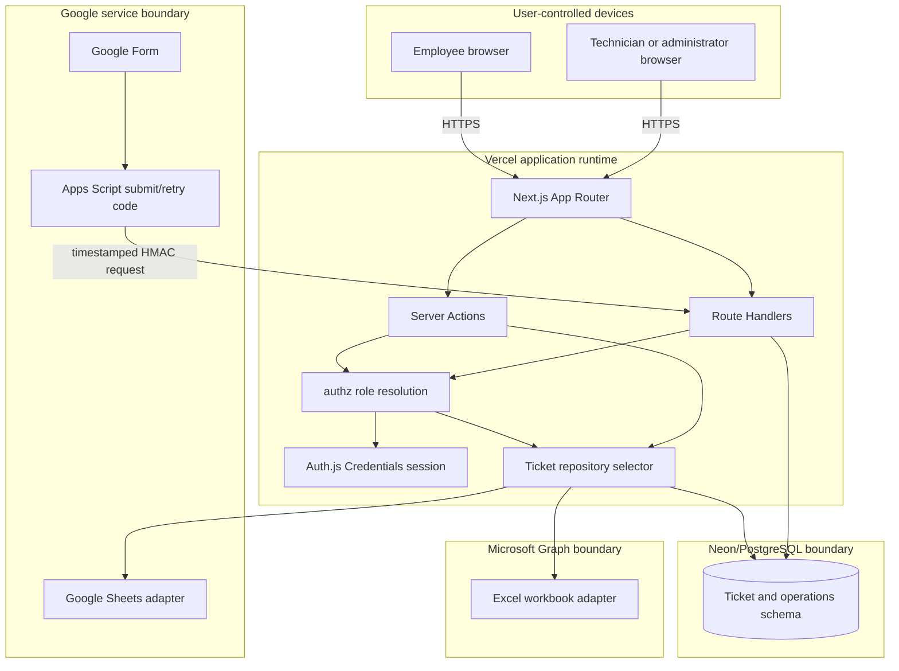

# Trust Boundaries

> **Source baseline:** `f4ead9f0225de23b75c0e5b22dcc7f4f1713a535`  
> **Evidence date:** 2026-11-20  
> **Interpretation:** source controls are described as implemented in code; production configuration and effective reachability are stated separately.

## Boundary diagram

## Browser to application

The browser is untrusted. Client-side UI visibility is not the permission boundary. Relevant server enforcement points include:

- `requireEmployee()`, `requireAgent()`, and `requireAdmin()` in `src/lib/authz.ts`.
- Ticket create/update actions in `src/app/(portal)/actions.ts`.
- Ticket read API in `src/app/api/tickets/[ticketNumber]/route.ts`.
- Ticket attachment API in `src/app/api/tickets/[ticketNumber]/attachments/route.ts`.
- Repository-level checks in `src/lib/sql/repository.ts` and `src/lib/google-sheets/repository.ts`.

Vercel deployment protection was reported enabled for deployment URLs except custom domains. That is a platform access layer. It does not establish employee identity, application role, requester-ticket ownership, MFA, or authorization for individual actions.

## Session and role boundary

`src/auth.ts` configures only a shared Credentials provider. Its `authorize()` function refuses authentication unless `DATA_BACKEND === "sql"`. When it does authenticate, it returns one shared identity. The JWT/session callbacks persist the identity marker, and the session cookie is HTTP-only, same-site lax, and secure in production.

`src/lib/authz.ts` resolves that identity to `IT_AGENT` in SQL mode. `requireAdmin()` then rejects it. In non-SQL mode, `getOptionalEmployee()` uses session email and `staffRole()` before calling the selected repository’s `getEmployeeByEmail()`.

### Google Sheets role risk

`GoogleSheetTicketRepository.getEmployeeByEmail()` returns `ADMIN` for any nonempty normalized email. If a non-shared session reaches the non-SQL authz branch and the Google Sheets adapter is selected, the repository role can override an `IT_AGENT` allowlist identity and satisfy `requireAdmin()`.

At this source baseline, the only configured provider refuses new authentication in non-SQL mode; SQL mode returns the shared account as `IT_AGENT` without calling that lookup. Therefore, this is a conditional source-level risk, not confirmed production exposure. It becomes reachable if a non-SQL session issuer is introduced or an otherwise valid non-shared session is accepted, and Google is selected as ticket backend. Resolve the role source before enabling such a path.

## Ticket authorization boundary

`src/lib/domain/policy.ts` implements:

- Employee ticket reads only when requester UID or email matches; it denies employee reads if `requesterIdentityVerified === false`.
- Ticket management for `IT_AGENT` or `ADMIN`.
- Admin access only for `ADMIN`.
- Employee message creation only as `EMPLOYEE_REPLY`.
- IT message creation as `PUBLIC_REPLY` or `INTERNAL_NOTE`.
- Employee-visible message filtering that removes `INTERNAL_NOTE`.

The SQL repository applies these checks in `getTicketByNumber`, `updateTicket`, and `addMessage`; SQL ticket detail filters internal notes and suppresses event history for employees. However, verify all current pages and API routes use the same repository methods before describing the rule as universal.

The ticket list method accepts requester filters but does not itself receive an actor or enforce a role. Its callers must supply correct filters and authorization. A documentation claim that “all list results are access-controlled by the repository” would be unsupported by that implementation alone.

## Form-to-webhook boundary

The Apps Script-to-Next.js route is a separate integration boundary. In `src/app/api/intake/google-form/route.ts`, the handler:

- Requires SQL intake mode and required configuration or responds 503.
- Requires JSON; rejects non-JSON with 415.
- Caps body size at 20,000 bytes and returns 413 when exceeded.
- Validates an HMAC-SHA256 signature against the exact timestamp/body pair.
- Rejects timestamps more than five minutes from current time.
- Uses constant-time signature comparison.
- Validates the strict payload with Zod.
- Checks the configured source Form ID.
- Validates email suffix, request type, and conditional new-hire fields.
- Returns 4xx responses for malformed, unauthorized, unapproved, or invalid submissions and 503 for intake persistence failures.

The secret is not included in this documentation. Script properties and active production linkage were not verified. A prior Apps Script GUI showed trigger rows, but did not conclusively identify the project as the production-bound Form.

A Form-provided email is not authenticated identity. `createGoogleFormTicket()` sets `requesterIdentityVerified: false`; requester self-service reads are therefore denied by the employee policy. The exact operational follow-up process for Form tickets should be documented separately.

## Database boundary

SQL access is server-side through `src/lib/sql/client.ts:database()`. It selects `APP_DATABASE_URL ?? DATABASE_URL`, validates the URL with `assertSafeSqlConfiguration()`, and creates a PostgreSQL pool. The connection string is not exposed here.

Application code uses parameterized queries. SQL repository writes use transactions for ticket create/update and roll back on errors. Database-level integrity includes unique operation IDs, foreign keys, attachment constraints, and agreement immutability triggers. These controls do not prove least-privilege database grants; actual role privileges require database-owner review.

Neon schema presence and snapshot metadata were inspected, but effective runtime connection selection, access role, scheduled backup policy, and restore testing remain unknown.

## Attachments and agreement documents

### Ticket attachments

The ticket attachment route is gated by `DATA_BACKEND === "sql"` and uses `SqlTicketRepository` directly. Uploads check the request origin when supplied, session presence, ticket access, file type/size, and file signature bytes. The route sanitizes the filename and stores content in `lacc_attachments`; the repository additionally checks ticket ownership/read permission, a 3 MiB file ceiling, maximum 10 files per ticket, and maximum 20 MiB total.

Downloads require the same SQL mode and authenticated actor, verify the attachment belongs to the requested ticket, then re-check read access before returning bytes. Non-SQL mode returns 409. These route-specific facts should not be generalized to inventory attachments unless their routes are separately inspected.

Because the attachment route uses SQL ticket lookup while ticket selection is independent, a configuration where `DATA_BACKEND=sql` but the ticket adapter is Google or Graph can produce a split data path. Confirm production selectors before describing which tickets have upload support.

### Agreements

Migration 012 adds database triggers that prevent mutation of a signed PDF record (except `access_attempts`), prevent deletion of a record with a signed PDF, and make agreement event rows append-only. The event table also limits one electronic-signature event per agreement.

Those are database controls in source migration DDL. They do not prove that all environments have applied migration 012, that database owners cannot alter schema/triggers, or that document routes enforce every expected identity/authorization rule. Review the agreement route and application service before making stronger claims.

## Third-party integrations

- **Google Sheets:** selected only through ticket backend selection; behavior and permissions differ from SQL.
- **Google Forms/Apps Script:** signed request path described above; trigger identity, script owner, and secret rotation are runtime ownership questions.
- **Microsoft Graph/Excel:** source adapter uses workbook session setup and Graph access-token code. Effective tenant permissions, workbook identity, and production use were not verified.
- **Translation:** `src/lib/domain/translation.ts` can send Spanish ticket text to a public Google Translate endpoint with a four-second timeout. Whether it is invoked in a production request path is unknown; privacy approval should be established before describing this as an approved feature.

## Outside the implemented application

The audited repository contains no Exchange provisioning integration, .NET worker service, or C# automation component. Their design is intentionally not documented here because implementation has not been written.

## Threats and controls

| Threat | Source control/evidence | Remaining uncertainty |
|---|---|---|
| Unauthenticated app operation | Auth.js session resolution and server-side guards | Effective production auth configuration and session issuer |
| Employee reading another requester’s ticket | `canReadTicket()` requester match; repository detail checks | Confirm all read/list paths apply equivalent filtering |
| Employee reading Form-submitted ticket | Unverified requester flag denies employee read | Staff review and identity verification workflow |
| Agent gaining admin via Google adapter | Current SQL shared identity resolves only to agent; `requireAdmin()` requires admin | Google adapter lookup returns admin for any email if reached from non-SQL authenticated path |
| Forged Form webhook | HMAC, timestamp window, request-size and strict schema checks | Script properties, secret lifecycle, and production Form linkage |
| Duplicate Form delivery | Deterministic operation UID and unique indexes | Runtime retry/spool health and reconciliation procedure |
| Internal note disclosure | Policy filter and SQL detail filtering | All routes/pages must be verified; provider behavior differs |
| Unauthorized attachment access | Session, ticket read policy, file signature and size checks | Active selector combination; inventory attachment path reviewed separately |
| Signed agreement alteration | Migration 012 trigger functions and constraints | Applied migration state and database-owner privileges |

## Evidence and ownership

| Evidence | Owner for remaining confirmation |
|---|---|
| `src/auth.ts`, `src/lib/authz.ts`, `src/lib/identity.ts` | Application and Entra owners |
| `src/lib/domain/policy.ts`, ticket and attachment routes | Application/security owners |
| `src/app/api/intake/google-form/route.ts`, `integrations/google-forms/Code.gs` | Application and Google Workspace owners |
| Migrations `001`–`012`, SQL client/repositories | Database owner |
| Vercel alias and project metadata | Vercel administrator |
