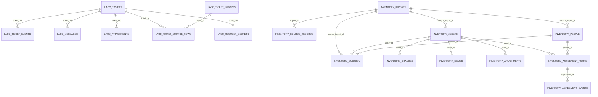

# Data Model and Schema

> **Source baseline:** `f4ead9f0225de23b75c0e5b22dcc7f4f1713a535`  
> **Evidence date:** 2026-11-20  
> **Scope:** migration DDL and source code only; no employee records were inspected.  
> **Runtime caveat:** Neon metadata showed application table families in production and preview, but active request routing and exact applied migration versions were not verified.

This document describes the schema as constructed by migrations `001` through `012` in source order. It is not a substitute for checking the live database catalog before a migration or data repair.

## Schema relationship map

The diagram shows explicit foreign keys from the migration DDL. Ticket payload properties inside `jsonb` are not expanded into SQL columns. Inventory audit/event rows are polymorphic and therefore have no declared foreign key to their target entity.

`INVENTORY_AUDIT_EVENTS` and `IT_OPERATIONS_AUDIT` use entity type and entity ID fields but declare no foreign key. `LACC_TICKET_EVENTS` is not the same table as `INVENTORY_AUDIT_EVENTS`.

## Migration 001 — Ticket core

Source: [`migrations/001_tickets.sql`](https://github.com/kooshxo/lacc-it-support/blob/f4ead9f0225de23b75c0e5b22dcc7f4f1713a535/migrations/001_tickets.sql)

### `lacc_tickets`

| Column | Type | Constraints/default | Meaning |
|---|---|---|---|
| `uid` | `text` | Primary key | Internal ticket identifier |
| `number` | `text` | `NOT NULL`, unique | Display ticket number |
| `operation_uid` | `text` | `NOT NULL`, unique | Idempotency identifier for the creating operation |
| `requester_uid` | `text` | `NOT NULL` | Requester identifier used for SQL filtering |
| `version` | `integer` | `NOT NULL`, `CHECK (version > 0)` | Optimistic concurrency version |
| `data` | `jsonb` | `NOT NULL` | Serialized domain `Ticket` object |
| `created_at` | `timestamptz` | `NOT NULL`, default `now()` | Database creation time |

Indexes and keys:

- Primary key on `uid`.
- Unique constraints on `number` and `operation_uid`.
- Index `lacc_tickets_requester` on `requester_uid`.

The schema stores most ticket fields inside `data`, not as individual relational columns. The repository reads `data` and separately uses `uid`, `number`, `operation_uid`, `requester_uid`, `version`, and timestamps for lookup, uniqueness, and concurrency behavior.

### `lacc_ticket_events`

| Column | Type | Constraints/default |
|---|---|---|
| `uid` | `text` | Primary key |
| `ticket_uid` | `text` | `NOT NULL`, foreign key to `lacc_tickets(uid)` |
| `operation_uid` | `text` | `NOT NULL`, unique |
| `data` | `jsonb` | `NOT NULL` |
| `created_at` | `timestamptz` | `NOT NULL`, default `now()` |

The foreign key has no explicit `ON DELETE` action, so PostgreSQL’s default restrictive behavior applies. Event properties are stored in JSON, represented in source by `TicketEvent`.

### `lacc_messages`

| Column | Type | Constraints/default |
|---|---|---|
| `uid` | `text` | Primary key |
| `ticket_uid` | `text` | `NOT NULL`, foreign key to `lacc_tickets(uid)` |
| `operation_uid` | `text` | `NOT NULL`, unique |
| `data` | `jsonb` | `NOT NULL` |
| `created_at` | `timestamptz` | `NOT NULL`, default `now()` |

The foreign key has no explicit delete cascade. Message content and type are serialized in `data`.

### `lacc_request_secrets`

| Column | Type | Constraints/default |
|---|---|---|
| `ticket_uid` | `text` | Primary key and foreign key to `lacc_tickets(uid)` |
| `encrypted_pin` | `text` | `NOT NULL` |

The source calls `encryptPin` before inserting the optional PIN. The DDL does not define encryption; key handling and cryptographic behavior are in `src/lib/sql/secrets.ts`. Do not store or document plaintext PINs.

## Migration 002 — Inventory base

Source: [`migrations/002_inventory.sql`](https://github.com/kooshxo/lacc-it-support/blob/f4ead9f0225de23b75c0e5b22dcc7f4f1713a535/migrations/002_inventory.sql)

### `inventory_imports`

| Column | Type | Constraints/default |
|---|---|---|
| `id` | `text` | Primary key |
| `source_sha256` | `text` | `NOT NULL`, unique |
| `metadata` | `jsonb` | `NOT NULL` |
| `imported_at` | `timestamptz` | `NOT NULL`, default `now()` |

The source hash is unique across imports.

### `inventory_source_records`

| Column | Type | Constraints/default |
|---|---|---|
| `import_id` | `text` | `NOT NULL`, foreign key to `inventory_imports(id)` |
| `table_name` | `text` | `NOT NULL` |
| `ordinal` | `integer` | `NOT NULL` |
| `data` | `jsonb` | `NOT NULL` |

Composite primary key: `(import_id, table_name, ordinal)`. The import foreign key has no explicit delete action.

### `inventory_people`

| Column | Type | Constraints/default |
|---|---|---|
| `id` | `text` | Primary key |
| `source_import_id` | `text` | Nullable foreign key to `inventory_imports(id)` |
| `data` | `jsonb` | `NOT NULL` |

Migrations 005 adds `version` and `updated_at`; see the migration evolution section below.

### `inventory_assets`

| Column | Type | Constraints/default |
|---|---|---|
| `id` | `text` | Primary key |
| `source_import_id` | `text` | Nullable foreign key to `inventory_imports(id)` |
| `version` | `integer` | `NOT NULL`, default `1` |
| `data` | `jsonb` | `NOT NULL` |
| `updated_at` | `timestamptz` | `NOT NULL`, default `now()` |

Expression unique index `inventory_asset_code` on `(data->>'asset_code')`. PostgreSQL permits multiple `NULL` values in a unique index unless configured otherwise; the DDL does not require that JSON property to exist.

### `inventory_custody`

| Column | Type | Constraints/default |
|---|---|---|
| `id` | `text` | Primary key |
| `asset_id` | `text` | `NOT NULL`, foreign key to `inventory_assets(id)` |
| `person_id` | `text` | `NOT NULL`, foreign key to `inventory_people(id)` |
| `source_import_id` | `text` | Nullable foreign key to `inventory_imports(id)` |
| `returned_at` | `timestamptz` | Nullable |
| `data` | `jsonb` | `NOT NULL` |

Partial unique index `inventory_one_open_custody` on `asset_id` where `returned_at IS NULL` permits at most one open custody row per asset. Foreign keys have no explicit delete actions.

### `inventory_changes`

| Column | Type | Constraints/default |
|---|---|---|
| `id` | `text` | Primary key |
| `asset_id` | `text` | `NOT NULL`, foreign key to `inventory_assets(id)` |
| `actor_uid` | `text` | `NOT NULL` |
| `event_type` | `text` | `NOT NULL` |
| `before_data` | `jsonb` | Nullable |
| `after_data` | `jsonb` | `NOT NULL` |
| `created_at` | `timestamptz` | `NOT NULL`, default `now()` |

The asset foreign key has no explicit delete action.

## Migration 003 — Ticket import provenance

Source: [`migrations/003_ticket_source_rows.sql`](https://github.com/kooshxo/lacc-it-support/blob/f4ead9f0225de23b75c0e5b22dcc7f4f1713a535/migrations/003_ticket_source_rows.sql)

### `lacc_ticket_imports`

| Column | Type | Constraints/default |
|---|---|---|
| `id` | `text` | Primary key |
| `source_sha256` | `text` | `NOT NULL`, unique |
| `source_id` | `text` | `NOT NULL` |
| `imported_rows` | `integer` | `NOT NULL` |
| `ticket_rows` | `integer` | `NOT NULL` |
| `metadata` | `jsonb` | `NOT NULL`, default `'{}'::jsonb` |
| `imported_at` | `timestamptz` | `NOT NULL`, default `now()` |

### `lacc_ticket_source_rows`

| Column | Type | Constraints/default |
|---|---|---|
| `import_id` | `text` | `NOT NULL`, foreign key to `lacc_ticket_imports(id)` |
| `source_row` | `integer` | `NOT NULL` |
| `ticket_uid` | `text` | Nullable foreign key to `lacc_tickets(uid)` |
| `headers` | `jsonb` | `NOT NULL` |
| `original_values` | `jsonb` | `NOT NULL` |

Composite primary key: `(import_id, source_row)`. Index `lacc_ticket_source_rows_ticket` on `ticket_uid`. Both foreign keys have no explicit delete action.

## Migration 004 — Ticket attachments

Source: [`migrations/004_ticket_attachments.sql`](https://github.com/kooshxo/lacc-it-support/blob/f4ead9f0225de23b75c0e5b22dcc7f4f1713a535/migrations/004_ticket_attachments.sql)

### `lacc_attachments`

| Column | Type | Constraints/default |
|---|---|---|
| `uid` | `text` | Primary key |
| `ticket_uid` | `text` | `NOT NULL`, foreign key to `lacc_tickets(uid)` with `ON DELETE CASCADE` |
| `filename` | `text` | `NOT NULL` |
| `mime_type` | `text` | `NOT NULL`, limited to PNG, JPEG, or PDF |
| `size` | `integer` | `NOT NULL`, greater than zero and at most 3,145,728 bytes |
| `uploaded_by` | `text` | `NOT NULL` |
| `uploaded_at` | `timestamptz` | `NOT NULL`, default `now()` |
| `content` | `bytea` | `NOT NULL` |

Index `lacc_attachments_ticket` on `(ticket_uid, uploaded_at)`. Although each stored attachment is capped at 3 MiB in SQL, the application repository also limits a ticket to 10 attachments and 20 MiB total. The input schema separately permits an upload size up to 10 MiB; repository and SQL checks are stricter.

## Migration 005 — Inventory versioning and audit

Source: [`migrations/005_inventory_operations.sql`](https://github.com/kooshxo/lacc-it-support/blob/f4ead9f0225de23b75c0e5b22dcc7f4f1713a535/migrations/005_inventory_operations.sql)

Adds to `inventory_people`:

| Column | Type | Constraints/default |
|---|---|---|
| `version` | `integer` | `NOT NULL`, default `1` |
| `updated_at` | `timestamptz` | `NOT NULL`, default `now()` |

Adds indexes:

- `inventory_source_records_table_order` on `(table_name, ordinal)`.
- `inventory_custody_asset_history` on `(asset_id, returned_at)`.

Creates `inventory_audit_events`:

| Column | Type | Constraints/default |
|---|---|---|
| `id` | `text` | Primary key |
| `entity_type` | `text` | `NOT NULL` |
| `entity_id` | `text` | `NOT NULL` |
| `actor_uid` | `text` | `NOT NULL` |
| `event_type` | `text` | `NOT NULL` |
| `before_data` | `jsonb` | Nullable |
| `after_data` | `jsonb` | `NOT NULL` |
| `created_at` | `timestamptz` | `NOT NULL`, default `now()` |

Index `inventory_audit_entity_history` on `(entity_type, entity_id, created_at DESC)`. This is a polymorphic audit table; `entity_id` is not a declared foreign key.

## Migration 006 — Inventory issues

Source: [`migrations/006_inventory_issues.sql`](https://github.com/kooshxo/lacc-it-support/blob/f4ead9f0225de23b75c0e5b22dcc7f4f1713a535/migrations/006_inventory_issues.sql)

### `inventory_issues`

| Column | Type | Constraints/default |
|---|---|---|
| `id` | `text` | Primary key |
| `asset_id` | `text` | `NOT NULL`, foreign key to `inventory_assets(id)` |
| `issue_type` | `text` | `NOT NULL`, one of `repair`, `missing`, `damaged` |
| `status` | `text` | `NOT NULL`, default `Open`, one of `Open`, `Resolved` |
| `reported_by` | `text` | `NOT NULL` |
| `reported_at` | `timestamptz` | `NOT NULL`, default `now()` |
| `resolution` | `text` | `NOT NULL`, default empty string |
| `resolved_by` | `text` | Nullable |
| `resolved_at` | `timestamptz` | Nullable |
| `data` | `jsonb` | `NOT NULL`, default `'{}'::jsonb` |

Partial unique index `inventory_one_open_issue_type` on `(asset_id, issue_type)` where `status='Open'`. Index `inventory_issue_queue` on `(status, reported_at DESC)`. The asset foreign key has no explicit delete action.

## Migration 007 — Inventory attachments

Source: [`migrations/007_inventory_attachments.sql`](https://github.com/kooshxo/lacc-it-support/blob/f4ead9f0225de23b75c0e5b22dcc7f4f1713a535/migrations/007_inventory_attachments.sql)

### `inventory_attachments`

| Column | Type | Constraints/default |
|---|---|---|
| `id` | `text` | Primary key |
| `asset_id` | `text` | `NOT NULL`, foreign key to `inventory_assets(id)` with `ON DELETE CASCADE` |
| `category` | `text` | `NOT NULL`, one of `agreement`, `repair`, `other` |
| `filename` | `text` | `NOT NULL` |
| `mime_type` | `text` | `NOT NULL`, limited to PNG, JPEG, or PDF |
| `size` | `integer` | `NOT NULL`, greater than zero and at most 3,145,728 bytes |
| `uploaded_by` | `text` | `NOT NULL` |
| `uploaded_at` | `timestamptz` | `NOT NULL`, default `now()` |
| `content` | `bytea` | `NOT NULL` |

Index `inventory_attachments_asset` on `(asset_id, uploaded_at)`.

## Migration 008 — Form response deduplication

Source: [`migrations/008_google_form_intake.sql`](https://github.com/kooshxo/lacc-it-support/blob/f4ead9f0225de23b75c0e5b22dcc7f4f1713a535/migrations/008_google_form_intake.sql)

Adds partial unique expression index `lacc_tickets_google_form_response` on:

- `data->>'sourceFormId'`
- `data->>'sourceFormResponseId'`

The index applies only where both JSON properties exist. It does not add separate SQL columns.

## Migration 009 — IT operations

Source: [`migrations/009_it_operations.sql`](https://github.com/kooshxo/lacc-it-support/blob/f4ead9f0225de23b75c0e5b22dcc7f4f1713a535/migrations/009_it_operations.sql)

### `it_onboarding_requests`

| Column | Type | Constraints/default |
|---|---|---|
| `id` | `text` | Primary key |
| `first_name` | `text` | `NOT NULL` |
| `last_name` | `text` | `NOT NULL` |
| `start_date` | `date` | `NOT NULL` |
| `requested_needs` | `jsonb` | `NOT NULL`, default `'[]'::jsonb` |
| `work_locations` | `jsonb` | `NOT NULL`, default `'[]'::jsonb` |
| `shared_drive_access` | `text` | `NOT NULL`, default empty string |
| `equipment_details` | `text` | `NOT NULL`, default empty string |
| `need_by_date` | `date` | Nullable |
| `main_contact_email` | `text` | `NOT NULL` |
| `requested_by` | `text` | `NOT NULL` |
| `status` | `text` | `NOT NULL`, default `New`, one of `New`, `In progress`, `Complete` |
| `created_at` | `timestamptz` | `NOT NULL`, default `now()` |
| `updated_at` | `timestamptz` | `NOT NULL`, default `now()` |

Index `it_onboarding_queue` on `(status, created_at DESC)`.

### `it_printer_directory`

| Column | Type | Constraints/default |
|---|---|---|
| `id` | `text` | Primary key |
| `location` | `text` | `NOT NULL`, unique |
| `ip_address` | `inet` | `NOT NULL` |
| `printer_model` | `text` | `NOT NULL`, default empty string |
| `notes` | `text` | `NOT NULL`, default empty string |
| `updated_by` | `text` | `NOT NULL` |
| `updated_at` | `timestamptz` | `NOT NULL`, default `now()` |

The schema stores an address value of PostgreSQL type `inet`; this document intentionally contains no configured address values.

### `it_operations_audit`

| Column | Type | Constraints/default |
|---|---|---|
| `id` | `text` | Primary key |
| `entity_type` | `text` | `NOT NULL` |
| `entity_id` | `text` | `NOT NULL` |
| `actor_uid` | `text` | `NOT NULL` |
| `action` | `text` | `NOT NULL` |
| `created_at` | `timestamptz` | `NOT NULL`, default `now()` |

Index `it_operations_audit_entity` on `(entity_type, entity_id, created_at DESC)`. There is no declared foreign key on the entity pair.

## Migration 010 — Authentication login limits

Source: [`migrations/010_auth_login_limits.sql`](https://github.com/kooshxo/lacc-it-support/blob/f4ead9f0225de23b75c0e5b22dcc7f4f1713a535/migrations/010_auth_login_limits.sql)

### `lacc_auth_login_limits`

| Column | Type | Constraints/default |
|---|---|---|
| `key_hash` | `text` | Primary key |
| `attempts` | `integer` | `NOT NULL`, `CHECK (attempts >= 0)` |
| `reset_at` | `timestamptz` | `NOT NULL` |
| `updated_at` | `timestamptz` | `NOT NULL`, default `now()` |

Index `lacc_auth_login_limits_expiry` on `reset_at`. The application hashes the client address before using it as the key; raw addresses are not the table key.

## Migration 011 — Agreement forms

Source: [`migrations/011_agreement_forms.sql`](https://github.com/kooshxo/lacc-it-support/blob/f4ead9f0225de23b75c0e5b22dcc7f4f1713a535/migrations/011_agreement_forms.sql)

### `inventory_agreement_forms`

Final columns after migration 011:

| Column | Type | Constraints/default |
|---|---|---|
| `id` | `text` | Primary key |
| `token_hash` | `text` | `NOT NULL`, unique |
| `asset_id` | `text` | `NOT NULL`, foreign key to `inventory_assets(id)` |
| `person_id` | `text` | `NOT NULL`, foreign key to `inventory_people(id)` |
| `data` | `jsonb` | `NOT NULL` |
| `terms_version` | `text` | `NOT NULL`, default `LACC-LAPTOP-ACKNOWLEDGEMENT-2026-11-17-v1` |
| `status` | `text` | `NOT NULL`, default `PENDING`, constrained to `PENDING`, `SIGNED`, `PRINTED`, `HANDED_OFF` at this stage |
| `signed_at` | `timestamptz` | Nullable |
| `printed_at` | `timestamptz` | Nullable |
| `handed_off_at` | `timestamptz` | Nullable |
| `printed_by` | `text` | Nullable |
| `handed_off_by` | `text` | Nullable |
| `revoked_at` | `timestamptz` | Nullable |
| `revoked_by` | `text` | Nullable |
| `access_attempts` | `integer` | `NOT NULL`, default `0`, constrained to 0–50 |
| `sign_attempts` | `integer` | `NOT NULL`, default `0`, constrained to 0–5 |
| `created_at` | `timestamptz` | `NOT NULL`, default `now()` |
| `updated_at` | `timestamptz` | `NOT NULL`, default `now()` |
| `expires_at` | `timestamptz` | `NOT NULL`, default `now() + interval '7 days'` |

Migration 011 includes `ADD COLUMN IF NOT EXISTS` statements and backfills existing rows: missing `terms_version` becomes `LEGACY-UNVERSIONED`; missing expiry is set to `created_at + 7 days`. It then makes both fields non-null and sets defaults.

Index `inventory_agreement_forms_asset_idx` on `(asset_id, created_at DESC)`. The asset/person foreign keys have no explicit delete action.

## Migration 012 — Signed agreement documents and event history

Source: [`migrations/012_signed_agreement_documents.sql`](https://github.com/kooshxo/lacc-it-support/blob/f4ead9f0225de23b75c0e5b22dcc7f4f1713a535/migrations/012_signed_agreement_documents.sql)

Adds to `inventory_agreement_forms`:

| Column | Type | Constraints/default |
|---|---|---|
| `signature_consent` | `boolean` | Nullable |
| `signature_consent_text` | `text` | Nullable |
| `signed_pdf` | `bytea` | Nullable |
| `signed_pdf_sha256` | `text` | Nullable |

Migration 012 replaces the status check to allow `PENDING`, `SIGNED`, `PRINTED`, `HANDED_OFF`, and `COMPLETED`.

Additional constraints:

- `signed_pdf` must be null or nonempty and have a lowercase 64-character hexadecimal `signed_pdf_sha256`.
- `COMPLETED` requires a non-null signed PDF, `signature_consent IS TRUE`, and non-null `signed_at`.

### `inventory_agreement_events`

| Column | Type | Constraints/default |
|---|---|---|
| `id` | `uuid` | Primary key |
| `agreement_id` | `text` | `NOT NULL`, foreign key to `inventory_agreement_forms(id)` with `ON DELETE RESTRICT` |
| `event_type` | `text` | `NOT NULL`, one of `LINK_CREATED`, `ELECTRONICALLY_SIGNED`, `REVOKED`, `LEGACY_PRINTED`, `LEGACY_HANDED_OFF` |
| `actor_type` | `text` | `NOT NULL`, one of `staff`, `signer` |
| `actor_uid` | `text` | Nullable |
| `actor_label` | `text` | `NOT NULL` |
| `occurred_at` | `timestamptz` | `NOT NULL`, default `now()` |
| `event_data` | `jsonb` | `NOT NULL`, default `'{}'::jsonb` |

Indexes:

- `inventory_agreement_events_agreement_idx` on `(agreement_id, occurred_at, id)`.
- Partial unique index `inventory_agreement_events_single_signature_idx` on `agreement_id` where `event_type='ELECTRONICALLY_SIGNED'`, limiting each agreement to one electronic-signature event.

Triggers and functions:

- `prevent_signed_agreement_document_mutation()` blocks any update to a form row after `signed_pdf` is set, except changes to `access_attempts`.
- `prevent_signed_agreement_delete()` blocks deletion of a form row with a signed PDF.
- `prevent_agreement_event_mutation()` blocks all updates and deletes to agreement events.
- The migration conditionally grants `SELECT, INSERT` on `inventory_agreement_events` to role `lacc_runtime` if that role exists. This conditional grant does not establish the full role’s live privileges.

## Application-level constraints not expressed solely in DDL

The database constraints are only one layer of validation.

- `src/lib/domain/schemas.ts` validates ticket and attachment inputs.
- `src/lib/sql/repository.ts` checks ticket attachment count and total bytes, checks actor policy, and uses row versions for SQL ticket updates.
- `src/lib/sql/secrets.ts` encrypts optional ticket PIN values before persistence.
- `src/lib/sql/agreements.ts` and `src/lib/sql/agreement-state.ts` contain agreement-specific application behavior.

The database does not define every domain field as a typed column. Most ticket and inventory payload detail is JSON, so the application schema and repository code are part of the effective data contract.

## Migration execution and compatibility

The source includes `scripts/sql-migrate.mjs` and a separate `scripts/apply-auth-rate-limit-migration.mjs`. Source presence does not establish which actor applies migrations, which command is part of a release, or which migration version is currently applied in each environment.

Do not edit an already-applied migration to change live schema. Before a schema change, confirm the live catalog and migration history with the database owner, then use the approved new-migration process.

## Retention, backup, and ownership

The schema stores operational and personal data, including attachments and signed agreements. Authorized system owners must define data retention, deletion approvals, backup, and restore practices. The audit did not validate a restore; environment-specific recovery configuration is outside this public source reference.

## Runtime verification status

Schema metadata verifies table presence only. It does not prove:

- Which backend serves production requests.
- That every migration is applied in each environment.
- That application runtime roles have all required privileges.
- That agreement workflows or ticket SQL writes are active.

## Evidence and owners

| Topic | Source/evidence | Owner for unresolved runtime detail |
|---|---|---|
| Ticket, event, message, and attachment DDL | Migrations `001`, `004`; `src/lib/sql/repository.ts` | Database and application owners |
| Import provenance | Migrations `003`, `008` | Application and data owners |
| Inventory, custody, issues, audit | Migrations `002`, `005`–`007` | Inventory and database owners |
| Onboarding and printer directory | Migration `009` | IT operations and database owners |
| Login limit storage | Migration `010`; `src/lib/sql/auth-rate-limit.ts` | Application and database owners |
| Agreements | Migrations `011`, `012`; `src/lib/sql/agreements.ts` | Application, database, and IT operations owners |
| Applied migration version, privileges, retention, restore | Runtime administration not fully inspected | Database owner |

## Source links

- [`migrations/001_tickets.sql`](https://github.com/kooshxo/lacc-it-support/blob/f4ead9f0225de23b75c0e5b22dcc7f4f1713a535/migrations/001_tickets.sql#L2-L27)
- [`migrations/002_inventory.sql`](https://github.com/kooshxo/lacc-it-support/blob/f4ead9f0225de23b75c0e5b22dcc7f4f1713a535/migrations/002_inventory.sql#L2-L31)
- [`migrations/003_ticket_source_rows.sql`](https://github.com/kooshxo/lacc-it-support/blob/f4ead9f0225de23b75c0e5b22dcc7f4f1713a535/migrations/003_ticket_source_rows.sql#L2-L20)
- [`migrations/004_ticket_attachments.sql`](https://github.com/kooshxo/lacc-it-support/blob/f4ead9f0225de23b75c0e5b22dcc7f4f1713a535/migrations/004_ticket_attachments.sql#L2-L13)
- [`migrations/005_inventory_operations.sql`](https://github.com/kooshxo/lacc-it-support/blob/f4ead9f0225de23b75c0e5b22dcc7f4f1713a535/migrations/005_inventory_operations.sql#L2-L17)
- [`migrations/006_inventory_issues.sql`](https://github.com/kooshxo/lacc-it-support/blob/f4ead9f0225de23b75c0e5b22dcc7f4f1713a535/migrations/006_inventory_issues.sql#L2-L16)
- [`migrations/007_inventory_attachments.sql`](https://github.com/kooshxo/lacc-it-support/blob/f4ead9f0225de23b75c0e5b22dcc7f4f1713a535/migrations/007_inventory_attachments.sql#L2-L14)
- [`migrations/008_google_form_intake.sql`](https://github.com/kooshxo/lacc-it-support/blob/f4ead9f0225de23b75c0e5b22dcc7f4f1713a535/migrations/008_google_form_intake.sql#L3-L6)
- [`migrations/009_it_operations.sql`](https://github.com/kooshxo/lacc-it-support/blob/f4ead9f0225de23b75c0e5b22dcc7f4f1713a535/migrations/009_it_operations.sql#L4-L42)
- [`migrations/010_auth_login_limits.sql`](https://github.com/kooshxo/lacc-it-support/blob/f4ead9f0225de23b75c0e5b22dcc7f4f1713a535/migrations/010_auth_login_limits.sql#L2-L9)
- [`migrations/011_agreement_forms.sql`](https://github.com/kooshxo/lacc-it-support/blob/f4ead9f0225de23b75c0e5b22dcc7f4f1713a535/migrations/011_agreement_forms.sql#L2-L45)
- [`migrations/012_signed_agreement_documents.sql`](https://github.com/kooshxo/lacc-it-support/blob/f4ead9f0225de23b75c0e5b22dcc7f4f1713a535/migrations/012_signed_agreement_documents.sql#L3-L83)
