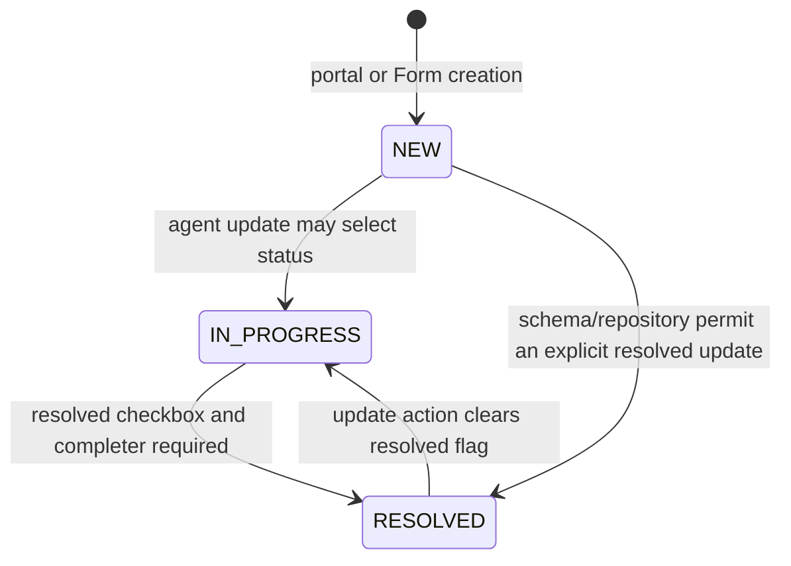

# Ticket Lifecycle and History

> **Source baseline:** `f4ead9f0225de23b75c0e5b22dcc7f4f1713a535`  
> **Evidence date:** 2026-11-20  
> **Runtime caveat:** the active production ticket adapter and live Form linkage are not confirmed.

This document traces the source behavior from input validation through repository persistence. SQL, Google Sheets, and Graph adapters do not provide identical lifecycle behavior.

## Ticket model

`src/lib/domain/models.ts:Ticket` contains:

- Identity: `ticketUid`, `ticketNumber`, `operationUid`.
- Requester: `requesterUid`, `requesterEmail`, `requesterName`, `requesterIdentityVerified`.
- Request: `subject`, `description`, `category`, `impact`, `workBlocked`, `workaroundAvailable`.
- Operations: `priority`, `status`, `assigneeUid`, `departmentUid`, `locationUid`, `assetUid`.
- Time/version: `createdAt`, `updatedAt`, `resolvedAt`, optional `reopenedAt`, `version`.
- Resolution/history: optional `completedBy`, `historicalStaff`, `resolutionNotes`, `sourceSolvedValue`, `sourceSolvedDate`, `completionTimestamp`.
- Import/intake provenance: optional `sourceTicketNumber`, `sourceSpreadsheetRow`, `sourceFormId`, `sourceFormResponseId`.

In SQL, the ticket object is serialized in `lacc_tickets.data`; the SQL columns separately hold IDs, requester UID, version, and creation time.

## Status normalization

`src/lib/domain/models.ts` defines editable statuses `NEW`, `IN_PROGRESS`, `RESOLVED` and legacy values `ASSIGNED`, `WAITING_ON_USER`, `WAITING_ON_VENDOR`, `CLOSED`.

`canonicalTicketStatus()` in `src/lib/domain/ticket-status.ts` maps:

| Input | Canonical value |
|---|---|
| `IN_PROGRESS`, `ASSIGNED`, `WAITING_ON_USER`, `WAITING_ON_VENDOR` | `IN_PROGRESS` |
| `RESOLVED`, `CLOSED`, `SOLVED` | `RESOLVED` |
| `NEW`, `RECEIVED`, null, unknown input | `NEW` |

Labels are Received, In Progress, and Solved. The update schema accepts only the editable values; legacy values are for reading/normalization, not new edits.

## Creation paths

### Employee portal action

`createTicketAction()` in `src/app/(portal)/actions.ts`:

1. Calls `requireEmployee()`.
2. Maps submitted FormData fields into the creation payload.
3. Validates using `ticketCreateSchema`.
4. Returns field-level validation errors on invalid data.
5. Calls `getRepository().createTicket()`.
6. Redirects to the newly created request on success.
7. Converts `WorkbookUnavailableError` to an action error; other errors are rethrown.

`ticketCreateSchema` requires a UUID operation UID; subject length 4–140; description 10–8,000; category 2–80; impact enum; boolean blockage/workaround; and bounded optional location/asset identifiers. It also supports an optional 4–12 digit preferred PIN.

Whether this action is usable by employee sessions in production is not established by the source deployment evidence: baseline authentication is a shared Credentials provider accepted only when `DATA_BACKEND === "sql"` and maps to a generic IT agent.

### Google Forms intake

The route `src/app/api/intake/google-form/route.ts` is a separate unauthenticated-by-session intake boundary protected by signed request validation.

Checks and failure responses include:

| Check | Failure |
|---|---|
| SQL backend and required intake configuration enabled | 503 |
| JSON content type | 415 |
| Body above 20,000 bytes | 413 |
| Missing/empty body or malformed JSON | 400 |
| HMAC/timestamp check | 401 |
| Strict payload validation | 422 |
| Form ID mismatch | 403 |
| New-hire request fields inconsistent with request type | 422 |
| Unsupported request type or required replacement details missing | 422 |
| Database creation error | 503 with `Retry-After` |

The HMAC is SHA-256 over timestamp plus body; timestamps outside a five-minute window are rejected. Request body size is enforced both from the declared content length and while reading the stream.

For ordinary ticket requests, the route calls `createGoogleFormTicket()`. For new-hire setup, it calls `createOnboardingRequest()` instead. The handler returns 201 for a new record and 200 for a duplicate.

The Google Form requester is built with `requesterIdentityVerified: false`. The email is user-supplied and validated against the configured LACC email suffix, but the code explicitly does not treat it as authenticated identity. In SQL policy, an employee cannot read a ticket whose requester identity is unverified. Do not document Form email as proof of identity.

### Form-to-SQL idempotency

`googleFormOperationUid(formId, responseId)` derives a deterministic UUID using SHA-256 of the two identifiers. `createGoogleFormTicket()` inserts the ticket and its initial `CREATED` event in one transaction. It uses the unique operation UID and migration 008’s partial unique index over Form/response identifiers to prevent duplicate creation.

If an insert conflicts, the code fetches the existing record and verifies that its source Form and response identifiers match. If not, it throws an identity conflict. The transaction rolls back on errors.

`integrations/google-forms/Code.gs` contains `laccOnFormSubmit` and `retryLaccTicketSubmissions` logic and an installer. The installer checks Script Properties and the active Form, installs form-submit and time-based triggers, and alters Form settings/removes the response destination. The presence of this code does not prove the installer was run on the production Form. A previous GUI view showed trigger rows in a project whose connection to the target production Form was not conclusive.

## SQL ticket creation

`SqlTicketRepository.createTicket()`:

1. Generates a random ticket UID and timestamp.
2. Creates a ticket number from the UID and calculates initial priority with `suggestedPriority()`.
3. Starts a database transaction.
4. Inserts ticket data with `ON CONFLICT(operation_uid) DO NOTHING`.
5. On duplicate operation UID, loads the prior ticket and checks that the requester UID matches.
6. Optionally encrypts and stores a preferred PIN.
7. Inserts a `CREATED` event only for a newly inserted ticket.
8. Commits; on error, rolls back and rethrows.

Priority suggestion is deterministic in `src/lib/domain/policy.ts`; highest priority requires broad impact, blocked work, and no workaround. The suggestion is initial classification, not a service-level guarantee.

## Technician updates, assignment, and resolution

### Update action

`updateTicketAction()`:

1. Calls `requireAgent()`.
2. Interprets the `resolved` checkbox. If checked, requested status is `RESOLVED`; otherwise a current `RESOLVED` ticket is set to `IN_PROGRESS`, and other current status values are retained.
3. For Google backend selection, reads allowed staff options and normalizes the submitted completer.
4. Validates version, operation UID, status, priority, completed-by, resolution notes, and internal note using `ticketUpdateSchema`.
5. Requires a nonempty `completedBy` when resolving.
6. Calls the repository update.
7. Revalidates the request and `/it` queue.
8. Converts authorization, conflict, not-found, and workbook-unavailable exceptions into action errors; other errors propagate.

The schema does not include `assigneeUid`. The action does not pass an assignee. The SQL update method’s editable fields are priority, completed-by, and resolution notes, plus status transition logic. The Google Sheets update also writes status/completion/resolution fields, not assignment. Although `assigneeUid` exists on the Ticket model and `TicketFilter` supports filtering by it, assignment is not implemented by the examined ticket update path. Any separate assignment UI or behavior must be independently verified before documentation claims it exists.

### SQL update transaction

`SqlTicketRepository.updateTicket()`:

1. Requires `canManageTickets(actor)`.
2. Begins a transaction and selects the ticket `FOR UPDATE`.
3. Returns not-found if there is no row.
4. Checks existing event/message rows for the operation UID to handle replay. A replay must match ticket and actor identity.
5. Compares stored version with `expectedVersion`; mismatch throws `ConflictError`.
6. Canonicalizes current and requested status.
7. Applies permitted fields.
8. On transition to resolved, sets `resolvedAt`, clears `reopenedAt`, and stores the submitted completer.
9. On transition away from resolved, sets `reopenedAt` when prior ticket data is resolved, and clears `resolvedAt` and `completedBy`.
10. If there are changed fields, increments version, updates the row, and writes an `UPDATED` event with before/after JSON.
11. If an internal note is present, inserts a separate `INTERNAL_NOTE` message.
12. Commits; on error, rolls back and rethrows.

No assignment is performed by this method. Also, an internal note is stored as a message; it is not a `TicketEvent` field update.

### Google Sheets update path

`GoogleSheetTicketRepository.updateTicket()` checks agent/admin policy and the row version, then directly writes sheet cells for status, update time, resolution marker, completion staff, resolution time, and optional resolution notes. It does not create SQL-style `lacc_ticket_events` or message records. `addMessage()` and `addAttachment()` throw `WorkbookUnavailableError`; `listEvents()` returns an empty array. Therefore, lifecycle history differs materially by backend.

### Graph adapter

The source includes `GraphTicketRepository`, which maps workbook rows to Ticket objects and uses a Graph workbook session. The exact live workbook and permissions are runtime configuration and were not inspected. Do not assume its event, message, or assignment semantics match SQL without tracing the relevant Graph methods and confirming the selected backend.

## State diagram

This diagram represents canonical values and implemented SQL reopening behavior; it does not claim that every UI transition is exposed in every adapter.

A resolved update from the portal action additionally requires a normalized completed-by value. Direct repository callers must still satisfy the input schema and authorization contract.

## Activity and messages

`TicketEvent` stores event UID, operation UID, ticket UID, actor UID, event type, field list, before/after values, and timestamp. SQL creation creates a `CREATED` event. SQL updates create `UPDATED` events when ticket fields change. Events are returned to IT roles by SQL ticket detail; employees receive an empty event list.

`TicketMessage` stores author identity/name, message type, body, and timestamp in serialized message data. Policy rules in `src/lib/domain/policy.ts` permit employees to read only their tickets when identity is verified and to create only `EMPLOYEE_REPLY`; IT agents/admins can create `PUBLIC_REPLY` or `INTERNAL_NOTE`. The SQL repository filters internal notes from employee-visible messages.

`describeTicketEvent()` turns stored events into display text for status, priority, completer, resolution notes, and internal-note fields. `ticketEventActor()` keeps `shared-it` generic rather than presenting it as an individual.

These are source rules. Verify every API and page read path before treating filtering as universal.

## Resolution and imported history

`src/lib/domain/resolution.ts` supports source-era fields. Completion values include common affirmative/completed labels; blank and placeholder values such as `TBD`, `N/A`, `none`, or a dash are not considered real source values. A valid source date, completion timestamp, or historical staff value can indicate a legacy completed ticket.

Current explicit status takes precedence: `RESOLVED` is resolved; an explicitly non-resolved status with a valid `reopenedAt` is not considered resolved despite old source markers. `ticketResolutionTimestamp()` uses source resolution dates, completion timestamp, or current `resolvedAt`. Historical rows where `resolvedAt` merely equals `createdAt` without source completion time are excluded from rolling metrics.

`historicalStaff` and source completion fields are historical data, not active assignment. `effectiveCompletedBy()` prefers current `completedBy` for a resolved ticket and avoids attributing generic shared staff labels as an individual.

## Concurrency, replay, and consistency

- SQL updates use a row lock and `expectedVersion`; stale writes throw `ConflictError`.
- SQL create/update/message paths use unique operation identifiers and duplicate checks for idempotency.
- Form response identity has an additional unique index.
- Google Sheets uses `ticketMetadataVersion()` based on row metadata and checks expected version before writing; it does not provide SQL transaction semantics.
- SQL events/messages and spreadsheet cells are not one synchronized history. No bidirectional SQL-to-Sheet synchronization path was established by this review.
- The SQL and ticket backend selectors are independent; a Form route specifically writes SQL and can be disabled even if a different ticket adapter is available.

## Translation

`src/lib/domain/translation.ts` detects Spanish using a marker regex, then makes a no-store request to Google’s public translation endpoint with a four-second timeout. It returns `null` on empty/non-Spanish input, non-success response, malformed response, unchanged translation, or caught error. Source code does not establish whether the translation function is invoked in production or whether sending ticket text to that external service is approved. Confirm privacy and usage policy before describing it as a standard operational feature.

## Failure and recovery guidance

This section describes safe diagnostic actions, not production modifications.

| Failure | Source behavior | Safe next check |
|---|---|---|
| Ticket create validation error | Action returns field errors | Correct submitted fields; do not alter stored records |
| Create backend unavailable | `WorkbookUnavailableError` becomes action error | Confirm selected backend and provider health with owner |
| Duplicate operation | SQL returns prior record only if requester matches | Check request correlation ID; do not manually insert a duplicate |
| Form route disabled | 503 “intake is not enabled” | Ask deployment owner to verify backend and intake configuration metadata |
| Form signature rejected | 401 | Ask Google/app owners to compare timestamp and signing configuration without revealing secrets |
| Wrong Form ID | 403 | Confirm approved Form linkage with Workspace owner |
| Malformed/unsupported Form response | 422 | Compare payload field names and request type with route schema |
| Persistence failure | Route returns 503 and retry-after header | Inspect approved application/Apps Script logs; allow configured retry process |
| Stale ticket update | `ConflictError` | Reload ticket and review current values before retry |
| Not found or access denied | Typed repository error | Verify ticket reference and signed-in role; do not bypass authorization |
| Google Sheet message/attachment attempted | Repository returns unavailable error | Use only a separately approved supported workflow; do not assume SQL fallback |

No production ticket was submitted or updated as part of this review.

## Source links

- [`src/lib/domain/models.ts`](https://github.com/kooshxo/lacc-it-support/blob/f4ead9f0225de23b75c0e5b22dcc7f4f1713a535/src/lib/domain/models.ts)
- [`src/lib/domain/schemas.ts`](https://github.com/kooshxo/lacc-it-support/blob/f4ead9f0225de23b75c0e5b22dcc7f4f1713a535/src/lib/domain/schemas.ts#L4-L41)
- [`src/lib/domain/policy.ts`](https://github.com/kooshxo/lacc-it-support/blob/f4ead9f0225de23b75c0e5b22dcc7f4f1713a535/src/lib/domain/policy.ts#L3-L31)
- [`src/lib/domain/ticket-status.ts`](https://github.com/kooshxo/lacc-it-support/blob/f4ead9f0225de23b75c0e5b22dcc7f4f1713a535/src/lib/domain/ticket-status.ts#L3-L27)
- [`src/lib/domain/resolution.ts`](https://github.com/kooshxo/lacc-it-support/blob/f4ead9f0225de23b75c0e5b22dcc7f4f1713a535/src/lib/domain/resolution.ts#L6-L66)
- [`src/lib/domain/ticket-activity.ts`](https://github.com/kooshxo/lacc-it-support/blob/f4ead9f0225de23b75c0e5b22dcc7f4f1713a535/src/lib/domain/ticket-activity.ts#L26-L56)
- [`src/app/(portal)/actions.ts`](https://github.com/kooshxo/lacc-it-support/blob/f4ead9f0225de23b75c0e5b22dcc7f4f1713a535/src/app/%28portal%29/actions.ts#L15-L47)
- [`src/lib/sql/repository.ts`](https://github.com/kooshxo/lacc-it-support/blob/f4ead9f0225de23b75c0e5b22dcc7f4f1713a535/src/lib/sql/repository.ts#L19-L116)
- [`src/lib/google-sheets/repository.ts`](https://github.com/kooshxo/lacc-it-support/blob/f4ead9f0225de23b75c0e5b22dcc7f4f1713a535/src/lib/google-sheets/repository.ts#L108-L146)
- [`src/app/api/intake/google-form/route.ts`](https://github.com/kooshxo/lacc-it-support/blob/f4ead9f0225de23b75c0e5b22dcc7f4f1713a535/src/app/api/intake/google-form/route.ts#L46-L160)
- [`src/lib/sql/google-form-intake.ts`](https://github.com/kooshxo/lacc-it-support/blob/f4ead9f0225de23b75c0e5b22dcc7f4f1713a535/src/lib/sql/google-form-intake.ts#L23-L112)
- [`integrations/google-forms/Code.gs`](https://github.com/kooshxo/lacc-it-support/blob/f4ead9f0225de23b75c0e5b22dcc7f4f1713a535/integrations/google-forms/Code.gs)
