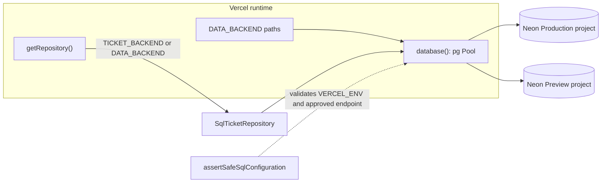

# Neon PostgreSQL

> **Source baseline:** `f4ead9f0225de23b75c0e5b22dcc7f4f1713a535`  
> **Evidence date:** 2026-11-20  
> **Runtime caveat:** no employee data, connection strings, or database credentials were inspected.

## Architecture

The application uses the `pg` package through `src/lib/sql/client.ts`. `database()` selects `APP_DATABASE_URL ?? DATABASE_URL`, validates the endpoint against `assertSafeSqlConfiguration()`, and creates a pool with maximum size 3 and 10-second connection and idle timeouts.

SQL ticket persistence is implemented in `src/lib/sql/repository.ts`; other modules include Form intake, IT operations, login rate limits, and agreements. Ticket SQL is an optional adapter selected through `TICKET_BACKEND`; `DATA_BACKEND` independently gates SQL-specific auth/operations and Form intake.

The diagram describes code and logically separate environments. It does not expose endpoint identifiers or prove which database the current deployment uses.

## Production and Preview

Prior metadata inspection found separate production and preview Neon projects. Application table families were present in both at the time inspected. This verifies schema metadata, not request traffic, data contents, or exact applied migration state.

`src/lib/config/runtime-safety.ts` requires an explicit `VERCEL_ENV` of Preview or Production for deployed database selection and permits environment-specific approved endpoints. It permits loopback SQL only for non-production local/test use. Endpoint values are intentionally omitted.

Environment separation should be checked together with Vercel selectors: a correct SQL host allowlist does not ensure the application selected SQL, and `TICKET_BACKEND` can select ticket storage independently from `DATA_BACKEND`.

## Schema and migration process

Migrations `001`–`012` define tickets, events/messages, attachments, imports, inventory, custody/issues/audit, onboarding/printers, login limits, and agreement/signature records. Full table/column definitions are in [Data Model and Schema](../data/model-and-schema.md).

Two migration scripts exist:

- `scripts/sql-migrate.mjs`: requires `DATABASE_URL`, executes every sorted `.sql` file with a single-connection pool, and logs applied filenames. It has no separate migration ledger or version comparison.
- `scripts/apply-auth-rate-limit-migration.mjs`: runs only in Vercel, applies migration 010 using `DATABASE_URL`, then grants access on the rate-limit table to the role named by `APP_DATABASE_URL`.

`package.json` does not define a migration command. The source does not establish who runs either script, whether Vercel build hooks invoke them, or whether the scripts reflect current operations practice. Do not infer that `next build` migrates the database.

Migration application is not equivalent to a tested rollback. Several migrations alter existing objects; application rollback must be checked for schema compatibility.

## Runtime privileges

Application access uses a connection string selected by the SQL client. Migration 012 conditionally grants `SELECT, INSERT` on agreement events to a runtime role if present; script 010 grants CRUD on the login-limit table to the role identified by `APP_DATABASE_URL`.

The repository health check in `src/lib/sql/repository.ts` checks table presence and selected privileges for ticket, inventory, and IT operations functions. It reports a static `schemaVersion: "009"` in the inspected source, even though later agreement migrations exist. Treat that health-check value as a legacy/stale marker, not as a reliable migration version.

Actual role grants, owner privileges, RLS status, and environment-specific permissions were not verified. Confirm them with the database owner; do not publish credential data.

## Backups and restore

Neon offers snapshot and point-in-time recovery features, but their availability and configuration for this environment must be confirmed by the database owner. This reference does not describe internal backup schedules, recovery windows, or untested procedures as verified.

## Monitoring and failure modes

Source-level signals include:

- SQL client throws when neither connection string is set.
- Unsafe or missing Vercel environment selection throws.
- `pg` connection timeout is 10 seconds.
- Repository `healthCheck()` checks selected tables and privileges and returns `healthy`, `degraded`, or `unconfigured`.
- Repository operations can throw typed authorization, conflict, not-found, or storage errors; low-level SQL failures may propagate or be mapped by Route Handlers/actions.

Potential operational failures include incorrect environment/endpoint selection, missing migration objects, insufficient runtime grants, connection exhaustion, network/database availability, schema mismatch, and transaction failure.

No production health check or data query was run for this documentation task. Use approved metadata/health procedures and redact all record content from diagnostics.

## Owner questions

- What migration version is applied to each project?
- Which role is used by the app, and which operations can it perform?
- Is there a scheduled or external backup not represented in inspected metadata?
- What does the six-hour history-retention field mean?
- What are approved RPO/RTO targets and retention rules?
- Has a snapshot/PITR restore been tested outside production, and who owns it?
- Who runs migrations and approves production schema changes?
