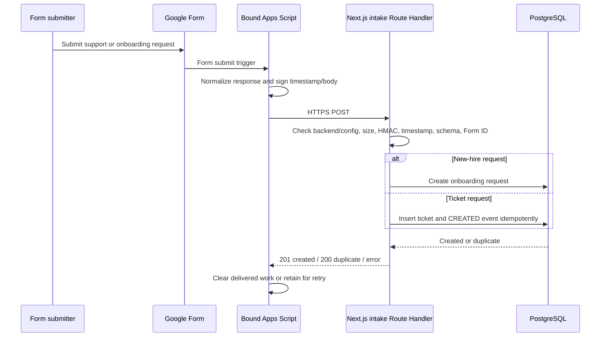

# Google Forms Intake

> **Source baseline:** `f4ead9f0225de23b75c0e5b22dcc7f4f1713a535`  
> **Evidence date:** 2026-11-20  
> **Status:** implemented in source; production Form/script linkage and successful delivery are not confirmed.

## Architecture

The route writes to SQL. It does not call the selected ticket repository, so a functioning Graph or Google Sheets ticket backend does not by itself enable this intake route.

## Apps Script behavior

Source file: `integrations/google-forms/Code.gs`.

- `installLaccTicketTriggers()` checks for webhook URL and signing secret properties and verifies that the active Form is the expected Form before proceeding.
- The installer configures Form questions/settings, removes existing matching triggers, installs `laccOnFormSubmit` on form submission, and installs `retryLaccTicketSubmissions` on a five-minute timer.
- After installing the SQL intake triggers, the script removes the Form’s response-sheet destination so new submissions are no longer sent there. The old response spreadsheet is described as an archive.
- A separate `installLaccTicketEditTrigger()` is restricted by source code to a synthetic test spreadsheet; it is not the production Form-intake trigger.
- The source defines a pending-delivery prefix, a maximum of 12 attempts, and a five-minute retry base. Retry scheduling uses exponential backoff capped at six hours. On retry exhaustion or a full queue, the script alerts that the response should be inspected in Forms.
- `planLaccRecovery()`, `dryRunLaccRecovery()`, and `recoverLaccSubmissionsAfterApproval()` provide source recovery helpers. The recovery function is not an automatic replacement for verifying normal trigger operation.

Trigger installation is state-changing: it modifies Form properties and triggers. This document describes the source only; no installer was run during discovery.

## Webhook validation

`src/app/api/intake/google-form/route.ts` is configured for the Node.js runtime and force-dynamic handling.

The route requires:

- `DATA_BACKEND === "sql"`.
- Webhook secret and source Form ID configuration.
- JSON content type.
- Request body no larger than 20,000 bytes.
- Timestamp header containing a Unix timestamp within five minutes of current time.
- SHA-256 HMAC signature over timestamp and exact body.
- Constant-time signature comparison.
- Strict Zod payload validation.
- Source Form ID equality.
- LACC email suffix validation and a supported request type.
- Matching request type and optional new-hire payload.

Failures return 503 when disabled; 415 for wrong content type; 413 for oversized input; 400 for missing or malformed body; 401 for invalid signature; 403 for the wrong Form; 422 for invalid fields/conditions; and 503 for persistence errors with a retry-after header.

The request URL, secret, Form IDs, and actual Form properties must not be included in this document.

## Ticket creation and deduplication

For ticket-type submissions, the route calls `createGoogleFormTicket()` in `src/lib/sql/google-form-intake.ts`.

- `googleFormOperationUid(formId, responseId)` derives a deterministic UUID from the two source identifiers.
- Ticket data stores `sourceFormId` and `sourceFormResponseId`.
- Migration `008_google_form_intake.sql` creates a partial unique index over those JSON properties.
- Ticket and `CREATED` event are inserted in a transaction.
- On conflict, the code loads the prior record and verifies its source identifiers.
- A repeat request returns success with `duplicate: true`; an identity conflict or database failure rolls back.

For new-hire submissions, the route calls `createOnboardingRequest()` with a derived operation identifier and returns an onboarding request ID rather than a ticket number.

Form-provided email is not verified identity. Form-created tickets mark `requesterIdentityVerified` false. Employee access policy does not permit retrieving such a ticket solely by matching the submitted email.

## Relationship to Google Sheets

There are three distinct concepts:

1. The Form may historically have had a response spreadsheet destination.
2. Apps Script source removes that destination when the SQL intake triggers are installed.
3. `GoogleSheetTicketRepository` is a separate ticket adapter that reads and updates a sheet.

The source does not establish bidirectional synchronization between SQL and the Google Sheets ticket adapter. Nor does it prove that a specific production Form is connected to the script.

A prior Apps Script GUI inspection showed a form-submit trigger and a time-based retry trigger with recent activity. The project title was generic and the inspection did not confirm its association with the intended production Form. Do not treat the trigger listing as proof that live submissions reach the production deployment.

## Failure recovery

Recommended owner-approved recovery sequence:

1. Confirm the target Form and bound Apps Script project through Workspace administration.
2. Review trigger status and Apps Script execution errors without displaying secrets or respondent data.
3. Check webhook response class and retry-spool status using approved logs.
4. For pending deliveries, use the documented retry function and verify duplicate handling by source response identity.
5. If trigger delivery was missed, inspect Form responses through the authorized owner workflow; use the recovery planner/dry run before any approved recovery.
6. Verify created SQL record metadata through an approved non-production or privacy-limited operational check.
7. Record the failure and recovery owner; do not manually create duplicates without checking source/operation identifiers.

No ticket was submitted or modified during discovery.

## Verified versus unknown

| Item | Status |
|---|---|
| Route, signature validation, payload schema, SQL write path | Verified in source |
| Retry/spool functions and installation logic | Verified in source |
| Trigger rows visible in an Apps Script view | Observed previously |
| Observed script project is the production-bound Form | Unknown |
| Script Properties and webhook secret configuration | Unknown and intentionally not inspected |
| Effective production `DATA_BACKEND` | Unknown |
| Recent successful end-to-end ticket delivery | Unknown; no submission performed |
| SQL-to-Sheet synchronization | Not implemented/verified by reviewed source |

## Owners and references

Owners: Google Workspace administrator (Form/script ownership and triggers), Vercel administrator (route configuration), application owner (validation and payload), database owner (SQL availability/reconciliation).

Source references: `integrations/google-forms/Code.gs`, `src/app/api/intake/google-form/route.ts`, `src/lib/sql/google-form-intake.ts`, `src/lib/sql/it-operations.ts`, `migrations/008_google_form_intake.sql`.
