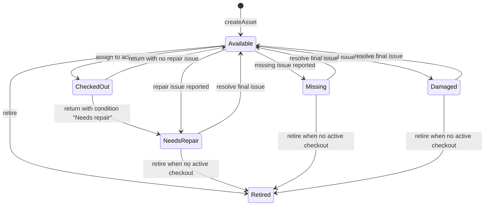

# Inventory and Custody Workflow

> **Source baseline:** `f4ead9f0225de23b75c0e5b22dcc7f4f1713a535`  
> **Evidence date:** 2026-11-20  
> **Runtime caveat:** inventory pages require `DATA_BACKEND=sql`; production selection and operational use were not verified.

## Scope and access

Inventory pages and Server Actions are under `src/app/(portal)/inventory/`. Pages call `requireAgent()` and check `DATA_BACKEND === "sql"`. The `inventoryAction()` and `personAction()` Server Actions repeat those checks before writing.

The source role gate accepts both `IT_AGENT` and `ADMIN`; it does not require administrator role for ordinary inventory operations. This is application-level access control. It does not establish which users can currently sign in or whether the feature is enabled in production.

## Lifecycle

Issue resolution recalculates status based on remaining open issues, retirement state, and active assignment. The diagram is conceptual; the underlying status is stored inside asset JSON rather than a database enum.

## Register and edit an asset

The inventory landing page calls `listAssets()` and `inventorySummary()`. It provides search, status/category filters, a 500-row cap, and a link to `/inventory/new`.

`/inventory/new` submits to `inventoryAction()` with `operation=create`. The action:

1. Requires an agent and SQL backend.
2. Validates the asset detail fields with a Zod schema.
3. Validates `asset_code` as nonempty and at most 80 characters.
4. Calls `createAsset()`.

`createAsset()` assigns a UUID, initializes status to `Available`, clears holder/assignment references, sets creation/update timestamps, inserts into `inventory_assets`, and records a `CREATED` row in `inventory_changes` in one transaction.

The asset detail page provides an edit form using `operation=save`. `mutateAsset()` locks the asset row, compares the submitted version, merges validated fields into JSON, increments the version, and writes a before/after `inventory_changes` row. A stale version raises `ConflictError`.

The form schema bounds asset fields and validates dates, nonnegative purchase cost, and the integer-like FortiClient field. Duplicate asset-code errors are mapped to a generic save message; the database has a unique expression index on `data->>'asset_code'`.

## People records

The People pages use `personAction()` in `src/app/(portal)/inventory/people/actions.ts` and `savePerson()` in `src/lib/inventory/repository.ts`.

Inputs include name, email, phone, person type, department/program, manager, start/end dates, notes, and active status. Email is either blank or a validated email. The action requires an agent and SQL backend. Updates require a positive version.

`savePerson()` creates or locks/updates the person row transactionally. On update it also updates open custody snapshots and current asset holder names, increments affected asset versions, and records `RECIPIENT_UPDATED` asset changes. Person create/update events go to `inventory_audit_events`.

Setting `is_active=false` does not delete a person or close custody automatically. New assignments reject inactive people.

## Assign equipment

The asset detail page shows the checkout form only for assets whose JSON status is `Available`. The `assign` operation requires an asset version and validates person ID plus checkout details.

`mutateAsset()`:

- Locks the asset and checks version.
- Requires status `Available`.
- Requires the selected person to exist and be active.
- Creates an `inventory_custody` row with recipient, issue date, expected return date, purpose, assignment type, condition/accessory snapshot, and actor.
- Updates the asset status to `Checked out`, sets holder/current assignment IDs, increments version, and records the before/after change.

The database partial unique index `inventory_one_open_custody` independently prevents more than one unreturned custody row for an asset. Conflict and uniqueness errors are surfaced as a refresh/duplicate message.

The assignment fields `acknowledgement_required`, `agreement_signed`, and related dates are custody metadata. They are not proof that a separate electronic agreement was created or signed.

## Return equipment

The `return` operation records return condition, accessories, notes, actor, and actual return date. The repository updates the open custody row and requires exactly one row to be returned; otherwise it raises an error asking staff to review custody.

The asset becomes `Available` unless return condition is `Needs repair`. In that case, status becomes `Needs repair` and a repair issue row is inserted if no conflicting open issue exists. The asset update and custody return are recorded in `inventory_changes`.

Do not mark equipment returned until physical custody is confirmed under IT procedures.

## Retirement

The `retire` operation records `Retired`, timestamp, and retirement reason in asset JSON and increments the asset version. It rejects retirement while the asset has a current assignment or checked-out/assigned status. Staff must return/check in the asset first.

Retirement does not delete the asset, custody history, source import records, issues, or attachments.

## Issues

The asset page permits repair, missing, or damaged reports unless the asset is retired. `createInventoryIssue()` locks the asset, checks version, inserts an issue with status `Open`, changes asset status, and records an `inventory_changes` row. Duplicate open issue type for the same asset maps to a specific conflict message.

The Issues page resolves an open issue through `resolveInventoryIssue()`:

- Locks asset and issue.
- Requires the issue to remain open.
- Stores resolution, actor, and timestamp.
- Recalculates asset status using remaining open issues, retirement state, and active assignment.
- Records the updated asset snapshot in `inventory_changes`.

## Attachments

`/api/inventory/[assetId]/attachments` has GET and POST handlers. They require a resolved non-employee actor and an existing asset. When an Origin header is present, it must match the request origin.

Uploads accept PNG/JPEG/PDF up to 3 MiB, verify file signatures, sanitize filenames, and store bytes in `inventory_attachments`. The repository allows at most 10 attachments and 20 MiB total per asset. It records an `ATTACHMENT_ADDED` event in `inventory_audit_events`.

Downloads require an attachment ID belonging to the asset and return bytes with `nosniff` and private/no-store headers. The API currently has no delete method in the route.

## Audit and history

- `inventory_changes`: asset before/after changes such as create, save, assign, return, retire, issue, and issue resolution.
- `inventory_audit_events`: person operations and selected operational events such as attachment addition; polymorphic entity references are not foreign keys.
- `inventory_custody`: assignment and return history.
- `inventory_issues`: issue lifecycle fields.

`assetHistory()` combines imported source records with `inventory_changes`; it does not replace the custody table. Audit coverage varies by operation, so do not assume every read or action has an audit entry.

## Failure handling and safe troubleshooting

The Server Action catches validation errors, stale-version conflicts, expected workflow errors, and unexpected persistence failures. It redirects with a user-facing error and revalidates inventory pages after success. Typical failures include SQL unavailable, stale record, duplicate asset code, inactive person, not-available asset, open custody inconsistency, attempted retirement while checked out, duplicate open issue, attachment size/count limit, and database failure.

Safe checks: confirm the actor role, feature selector, asset ID and page version; review source audit/custody records through approved IT access; refresh stale forms. Do not repair data by manually changing JSON or deleting custody/issues.

## Source references

- `src/app/(portal)/inventory/page.tsx`
- `src/app/(portal)/inventory/new/page.tsx`
- `src/app/(portal)/inventory/[id]/page.tsx`
- `src/app/(portal)/inventory/actions.ts`
- `src/app/(portal)/inventory/people/actions.ts`
- `src/lib/inventory/repository.ts`
- `src/app/api/inventory/[assetId]/attachments/route.ts`
- `migrations/002_inventory.sql`, `005_inventory_operations.sql`, `006_inventory_issues.sql`, `007_inventory_attachments.sql`
